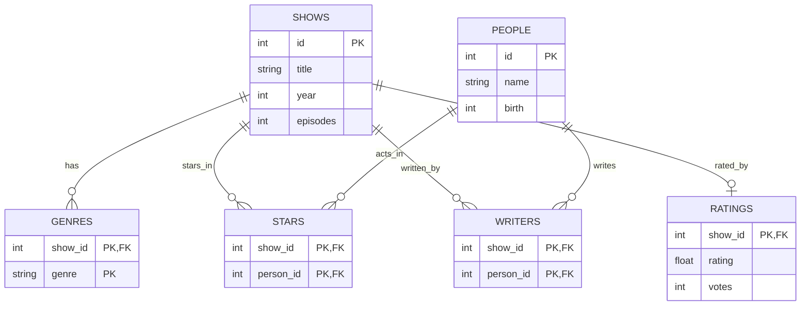

# TV Show Catalog — Entity Relationship Diagram

## Design decisions and assumptions

- `SHOWS` and `PEOPLE` use stable numeric IDs as primary keys.
- `STARS` and `WRITERS` are junction tables. Their two-column composite primary keys prevent duplicate show/person pairs in the same role.
- `GENRES` uses (`show_id`, `genre`) as a composite primary key, allowing multiple genres per show without a separate genre lookup table.
- Each `GENRES`, `STARS`, `WRITERS`, and `RATINGS` record refers to an existing show; each `STARS` or `WRITERS` record also refers to an existing person.
- A show may have zero or more recorded genres, stars, and writers. A person may have zero or more acting and writing credits.
- `RATINGS` is optional and has at most one aggregate rating per show; `show_id` is both its primary key and a foreign key.
- Episode count is stored as an integer; individual episodes, cast character names, and individual user votes are outside this design.
