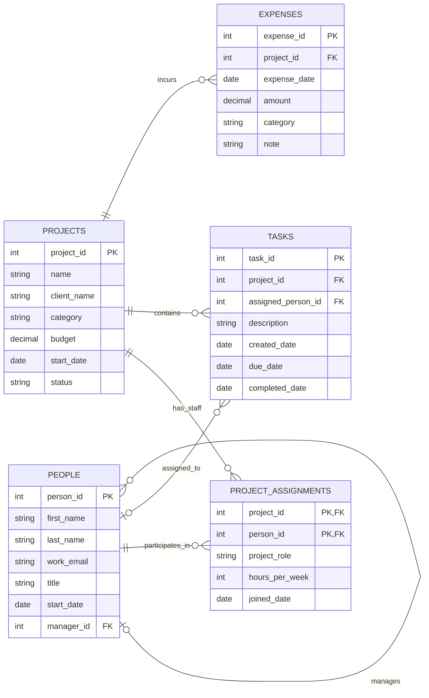

# BabsonAI Labs
### Project Operations Intelligence Database

**Database Project — Part A | Scenario A**

*A relational database designed to improve project visibility, employee workload management, expense monitoring, and operational decision-making.*

---

## 1. The Scenario

### Business Background

BabsonAI Labs is a fictional startup founded by Babson students that develops AI tools for small businesses. The company has approximately 25 employees and currently manages information through spreadsheets and chat threads.

As the company grows, tracking employee assignments, project budgets, deadlines, and expenses across separate systems becomes increasingly difficult.

A relational database would connect this information and help managers make more informed operational decisions.

### Business Problem

The company needs a centralized system to understand:

- Which employees are working on which projects.
- Whether employee workloads are balanced.
- How project expenses compare with approved budgets.
- Which tasks are overdue or incomplete.
- Whether task assignments follow the company's staffing rules.

### Primary Business Question

**Which projects are at risk of going over budget or falling behind schedule, and how can managers identify these risks early?**

### Information the Business Keeps

**Employees:** First name, last name, work email, job title, start date, and manager. The two founders have no manager, and work email addresses may change.

**Projects:** Project name, client name, category, budget, start date, and status. Internal projects may not have a client.

**Project Assignments:** The employee, project, role on that project, weekly committed hours, and date the employee joined the project.

**Tasks:** Project, task description, creation date, assigned employee, due date, and completion date. New tasks may be unassigned.

**Expenses:** Project, expense date, amount, category, and a short note.

### Business Rules

1. Every employee reports to at most one other employee.
2. Project budgets and expenses must be greater than zero.
3. Every task belongs to exactly one project.
4. Tasks may be unassigned.
5. A completed task cannot have a completion date before its creation date.
6. An employee must commit between 1 and 40 hours per week to an individual project.
7. Project status must be planned, active, paused, or done.
8. A task can only be assigned to an employee who works on its project.
9. A task cannot be assigned before that employee's start date.

### Data Requirements

The database will contain approximately:

| Record type | Planned volume |
|---|---:|
| Employees | 25 |
| Projects | At least 12 |
| Tasks | At least 250 |
| Expenses | At least 150 |

### Project Objectives

The database will support analysis of project budgets, employee workloads, task progress, and operational expenses while maintaining accurate relationships between records.

---

## 2. The ERD

### Database Architecture

The database contains five tables:

- **PEOPLE:** Employee information and reporting relationships.
- **PROJECTS:** Client and internal projects.
- **PROJECT_ASSIGNMENTS:** Employees' project participation and weekly commitments.
- **TASKS:** Work assigned within projects.
- **EXPENSES:** Spending associated with projects.

### Entity Relationship Diagram
### Database Components
| Color | Table | Business Function |
|---|---|---|
| 🔵 | PEOPLE | Employee management |
| 🟢 | PROJECTS | Project management |
| 🟣 | PROJECT_ASSIGNMENTS | Project staffing |
| 🟠 | TASKS | Task tracking |
| 🔴 | EXPENSES | Financial tracking |

### Understanding the Relationships

**Employee reporting:** An employee may have one manager or no manager. A manager may supervise several employees.

**Project staffing:** Employees can participate in multiple projects, and projects can have multiple employees. PROJECT_ASSIGNMENTS resolves this many-to-many relationship.

**Task management:** Every task belongs to one project, but a task may have no assigned employee.

**Expense tracking:** Every expense belongs to one project. A project may have no expenses.

---

## 3. What One Row Means

| Table | What one row represents |
|---|---|
| PEOPLE | One employee who works at BabsonAI Labs |
| PROJECTS | One client or internal project managed by BabsonAI Labs |
| PROJECT_ASSIGNMENTS | One employee's participation in one project, including their role and weekly committed hours |
| TASKS | One task created for a project, whether assigned or unassigned |
| EXPENSES | One expense recorded against one project |

### Why This Structure Matters

An employee's information is stored once in PEOPLE, even if the employee participates in multiple projects.

PROJECT_ASSIGNMENTS records the employee's participation in each project separately, including their project-specific role and hours.

This reduces duplication and allows managers to analyze employee workloads across projects.

---

## 4. Design Choices

### 1. Why did I choose these five tables?

I chose PEOPLE, PROJECTS, PROJECT_ASSIGNMENTS, TASKS, and EXPENSES because they represent the main information BabsonAI Labs needs to manage its operations.

Together, these tables connect employees to projects, track the work being completed, and record project spending.

### 2. Why does PROJECT_ASSIGNMENTS need its own table?

Employees can work on multiple projects, and each project can have multiple employees.

PROJECT_ASSIGNMENTS connects these two tables without duplicating employee or project information.

It also stores information specific to each assignment, such as the employee's project role and weekly committed hours.

### 3. How do primary and foreign keys support the design?

Primary keys uniquely identify records, while foreign keys establish relationships between tables.

For example, TASKS uses project_id to identify the project a task belongs to and assigned_person_id to identify the employee responsible for it.

These relationships help maintain consistent information across the database.

### 4. What design trade-offs did I make?

I kept the database focused on five tables rather than creating separate tables for clients, expense categories, or project statuses.

This makes the initial design easier to understand and implement.

One limitation is that the database does not track detailed employee timesheets or labor costs, so financial analysis focuses on recorded project expenses.

The design also allows tasks to be unassigned, reflecting how work may be created before an employee is selected.

---

## Additional Project Documentation

### Data Dictionary

| Table | Primary key | Foreign keys | Purpose |
|---|---|---|---|
| PEOPLE | person_id | manager_id | Stores employees and their reporting relationships |
| PROJECTS | project_id | None | Stores project details and budgets |
| PROJECT_ASSIGNMENTS | project_id + person_id | project_id, person_id | Connects employees to projects |
| TASKS | task_id | project_id, assigned_person_id | Tracks project tasks and assignments |
| EXPENSES | expense_id | project_id | Records project spending |

### Planned Data Validation

The database implementation will use constraints to protect data quality.

Examples include:

- Project budgets must be positive.
- Expenses must be positive.
- Project statuses must belong to the four allowed categories.
- Weekly project commitments must be between 1 and 40 hours.
- Completion dates cannot precede creation dates.
- Foreign keys must reference valid employees and projects.

### Project Staffing and Task Assignment Rules

An important business rule is that employees should only be assigned tasks on projects to which they are officially assigned.

For example, if an employee works on Project 101, the employee may receive tasks for Project 101.

The employee should not receive tasks for Project 202 unless a corresponding assignment exists in PROJECT_ASSIGNMENTS.

The database can verify this relationship through a query joining TASKS with PROJECT_ASSIGNMENTS.

The query will identify any task whose assigned employee does not have a corresponding project assignment.

The rule that a task cannot be assigned before an employee's start date also requires checking information across tables.

These checks will help identify invalid task assignments.

---

## Business Intelligence Applications

### A. Project Budget Monitoring

**Business question:** Which projects are approaching or exceeding their budgets?

Managers can compare total expenses with approved project budgets.

**Expense Utilization (%):**

`Total Project Expenses / Project Budget × 100`

For example, a project that has spent 90% of its budget could be flagged for management review.

The 90% threshold is an illustrative management rule, not an industry standard.

### B. Employee Workload Analysis

**Business question:** Which employees have the highest weekly commitments across active projects?

The database can combine PEOPLE, PROJECT_ASSIGNMENTS, and PROJECTS to calculate total committed hours.

**Weekly Committed Hours:**

`SUM(hours_per_week) across active projects`

Employees with commitments exceeding 40 hours per week could be flagged for workload review.

The 40-hour threshold across projects is an analytical warning threshold; the scenario's database constraint limits commitments to 40 hours on each individual project.

### C. Task Completion and Deadline Monitoring

**Business question:** Which projects have the most overdue tasks?

Managers can compare task due dates and completion dates against a chosen reporting date.

A task may be overdue when its due date has passed and it has not been completed.

The database can also identify tasks that were completed after their deadlines.

### D. Expense Category Analysis

**Business question:** Which types of expenses account for the largest share of spending?

Managers can analyze expenses by category:

- GPU cloud
- Data labeling
- Software
- Travel

This could help identify major cost drivers and opportunities to manage spending.

### E. Early Risk Identification

**Business question:** Which projects show early warning signs of exceeding budgets or missing deadlines?

The database can connect information from PROJECTS, TASKS, PEOPLE, PROJECT_ASSIGNMENTS, and EXPENSES to identify potential operational risks.

#### Financial Risk Indicators

Managers can monitor expense utilization by project.

**Expense Utilization (%):**

`SUM(Project Expenses) / Project Budget × 100`

A project with high expense utilization may require closer review.

The current scenario does not record employee pay rates or task-level labor costs, so this measure reflects recorded project expenses rather than complete project costs.

#### Scheduling Risk Indicators

Potential warning signs include:

- Multiple tasks overdue.
- Tasks completed after their due dates.
- Incomplete tasks that have been open for an unusually long period.
- Employees with high weekly commitments across active projects.
- Projects with a high number of unfinished tasks.

#### Management Applications

These indicators could support a future project operations dashboard that helps managers:

1. Identify projects requiring attention.
2. Monitor expenses before budgets are exceeded.
3. Review employee workload distribution.
4. Prioritize overdue tasks.
5. Improve resource allocation and project oversight.

**Important:** These indicators highlight possible risks. They do not guarantee that a project will exceed its budget or miss a deadline.

---

## Future Development

The database could eventually support an interactive business intelligence dashboard with the following metrics:

| Metric | Business value |
|---|---|
| Active Projects | Understand current project activity |
| Expense Utilization | Monitor spending against budgets |
| Overdue Tasks | Identify scheduling problems |
| Weekly Hours by Employee | Evaluate staffing distribution |
| Expenses by Category | Identify cost drivers |
| Unstaffed Tasks | Identify tasks needing assignment |
| Projects Without Expenses | Identify projects with no recorded spending |

### Potential Dashboard Features

Future improvements could include:

- Interactive project filters.
- Employee workload charts.
- Project expense visualizations.
- Overdue task summaries.
- Automated operational risk indicators.

These features are potential extensions rather than components already implemented.

---

## Project Summary

The BabsonAI Labs database connects employee management, project staffing, task execution, and expense tracking within one relational structure.

The design will help the company answer practical business questions about resource allocation, project progress, and financial performance.

By organizing operational information in a consistent database, BabsonAI Labs can improve visibility into its projects and support more informed management decisions.

**Central business objective:** Transform disconnected operational records into reliable information for business decision-making.

